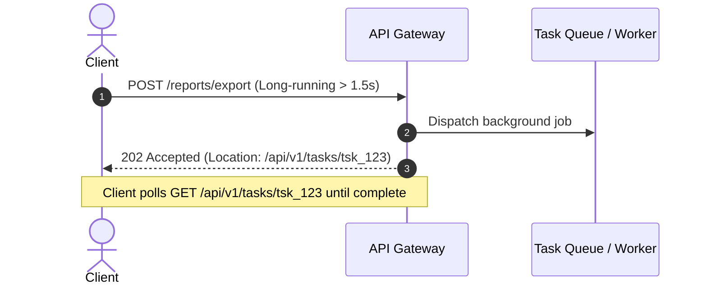

# API Architecture, Protocols & Communication Standards

> **Core Mandate:** Enforce standard HTTP semantics, synchronous vs. asynchronous processing (`202 Accepted`), capability metadata (`_actions`), safe mutations via idempotency keys, keyset cursor pagination, optimistic concurrency control (OCC), and RFC 8594 lifecycle versioning.

---

## 1. Standard HTTP Semantics & Status Codes

APIs must adhere strictly to standard HTTP semantics. Never return `200 OK` for error envelopes:

| Status Code | Semantic Purpose | When to Return |
|---|---|---|
| **`200 OK`** | Successful read or synchronous update | Standard `GET`, `PATCH`, `PUT` queries that return payloads. |
| **`201 Created`** | Successful resource creation | Synchronous `POST` with `Location: /api/v1/resources/:id` header. |
| **`202 Accepted`** | Asynchronous task accepted | Tasks exceeding latency budgets (> 1.5s) delegated to background queues. |
| **`204 No Content`** | Successful action with zero payload | Standard `DELETE` or empty mutation responses. |
| **`400 Bad Request`** | Malformed syntax or protocol violation | Unparseable JSON, invalid query parameters. |
| **`401 Unauthorized`** | Missing or invalid authentication | Missing, expired, or tampered JWT / API token. |
| **`403 Forbidden`** | Authenticated but insufficient permission | Role, tenant boundary, or policy guard denial. |
| **`404 Not Found`** | Resource does not exist | Unknown entity identifier (or masked tenant resource). |
| **`409 Conflict`** | State conflict or race condition | Concurrency mismatch (`If-Match`), unique constraint, or in-flight idempotency. |
| **`422 Unprocessable`** | Semantic validation failure | Schema constraint violation (RFC 9457 problem details). |
| **`500 Internal Error`** | Unhandled server exception | Unexpected server failure; never leak internal stack traces. |

### Subresource URL Conventions
- Express relational hierarchy cleanly: `/api/v1/organizations/:orgId/projects/:projectId/members`.
- Limit URL nesting to a maximum of 2 subresource levels; for deeper resources, access directly via canonical ID (`/api/v1/tasks/:taskId`).

### Enumeration Masking
- Authentication and recovery endpoints must never reveal user existence (e.g. return `"If an account exists, a recovery link has been sent"` with identical timing).

---

## 2. Synchronous vs. Asynchronous Processing (`202 Accepted`)

Operations with unpredictable or long execution durations (> 1.5 seconds, such as video rendering, large PDF exports, batch imports, or complex report generation) must never block synchronous HTTP request threads:



### Protocol Standards:
1. Dispatch the payload to a persistent worker queue (e.g., BullMQ, Temporal, Celery).
2. Respond immediately with **`202 Accepted`** containing:
   - Header: `Location: /api/v1/tasks/:taskId`
   - Envelope:
     ```json
     {
       "taskId": "tsk_123",
       "status": "QUEUED",
       "pollIntervalMs": 2000,
       "_links": {
         "status": { "href": "/api/v1/tasks/tsk_123", "method": "GET" },
         "cancel": { "href": "/api/v1/tasks/tsk_123", "method": "DELETE" }
       }
     }
     ```
3. Polling endpoint (`GET /api/v1/tasks/:taskId`) returns:
   - In-progress: `200 OK` with status `PROCESSING` and progress percentage.
   - Finished: `303 See Other` with `Location: /api/v1/reports/rep_789` or `200 OK` with `status: "COMPLETED"` and the final artifact URI.

---

## 3. Allowed Actions & Capability Metadata (`_actions` Envelope)

Clients must not duplicate complex server-side business and authorization rules to decide whether UI actions (edit, delete, approve, cancel, refund) are permitted. **The server is the authoritative source of truth.**

### Pattern: `_actions` and `_links` Envelope
When building hypermedia-driven or UI-facing APIs where user actions depend on permissions and lifecycle states, resource responses can embed an `_actions` boolean map and optional `_links` hypermedia block indicating what the requesting caller is permitted to do:

```json
{
  "id": "res_9876",
  "status": "ACTIVE",
  "title": "Production Deployment Pipeline",
  "_actions": {
    "canEdit": true,
    "canDelete": false,
    "canExecute": true
  },
  "_links": {
    "self": { "href": "/api/v1/resources/res_9876", "method": "GET" },
    "execute": { "href": "/api/v1/resources/res_9876/execute", "method": "POST" }
  }
}
```

### Frontend Binding:
- UI action buttons directly bind visibility or disabled state to `resource._actions.canExecute`.
- When authorization or lifecycle rules evolve, only backend policy changes—zero frontend redeployment required.

---

## 4. Safe Mutations via Idempotency Keys (IETF Draft)

To prevent duplicate execution caused by network retries or transient connection drops:

### Protocol Standards:
- Clients generating mutating requests (`POST`, `PATCH`) must supply a unique `Idempotency-Key: <uuid-v4>` header.
- **Server Execution Lifecycle**:
  1. Check distributed idempotency cache for key `idemp:<scopeId>:<idempotencyKey>` (where `scopeId` is tenant, user, or client identifier).
  2. If found with status `IN_FLIGHT`: return **`409 Conflict`** (`IDEMPOTENT_OPERATION_IN_PROGRESS`).
  3. If found with status `COMPLETED`: return the cached HTTP status code, headers, and response payload without re-executing.
  4. If not found: Acquire distributed lock, execute mutation within an atomic database transaction, cache the response envelope with a 24-hour TTL, and release the lock.

---

## 5. High-Scale Keyset / Cursor-Based Pagination

Never use offset pagination (`OFFSET 10000 LIMIT 20`) on large tables. Offsets degrade linearly ($O(N)$) and suffer from page-drift anomalies as rows are inserted or deleted.

### Specification & Envelope:
- Query Parameters: `?cursor=<opaque_base64>&limit=20` (default limit 20, max 100).
- Response Envelope:
  ```json
  {
    "data": [...],
    "pagination": {
      "nextCursor": "ZXlKaWRI...==",
      "hasMore": true,
      "limit": 20
    }
  }
  ```
- **Agnostic Keyset Query Pattern**:
  ```sql
  SELECT * FROM items
  WHERE partition_id = :partitionId
    AND (created_at, id) < (:cursorCreatedAt, :cursorId)
  ORDER BY created_at DESC, id DESC
  LIMIT :limit + 1;
  ```
  If `results.length > limit`, slice the extra item and encode its composite values (`created_at`, `id`) into the base64 `nextCursor`.


---

## 6. Optimistic Concurrency Control (OCC)

Prevent lost-update anomalies during concurrent edits without pessimistic database row locking:

### Protocol Standards:
- Every mutable entity contains an incrementing integer `version` column.
- The server returns the current entity version in the `ETag` response header: `ETag: W/"v4"`.
- Clients submitting updates (`PUT`, `PATCH`) must include `If-Match: W/"v4"`.
- **Atomic Concurrency Handling**:
  ```sql
  UPDATE orders 
  SET status = :status, version = version + 1 
  WHERE id = :id AND version = :expectedVersion;
  ```
  - If `rows_affected == 0`: Return **`409 Conflict`** with error code `CONCURRENCY_CONFLICT` and the latest entity representation.

---

## 7. API Versioning & RFC 8594 Lifecycle Deprecation

### URI Versioning Standard
- Standardize on explicit path versioning: `/v1/`, `/v2/`.
- Never introduce breaking changes within an active major version:
  - *Non-Breaking (Permitted in `/v1/`):* Adding optional fields, adding new endpoints, adding new enum variants.
  - *Breaking (Demands `/v2/`):* Renaming/removing fields, changing validation constraints, altering status codes.

### RFC 8594 Sunset & Deprecation Headers
When deprecating an endpoint, provide clients with a minimum 90-day grace period:
- `Deprecation: @<unix-timestamp>`: Date when the endpoint was deprecated.
- `Sunset: <HTTP-date>`: Absolute date when the endpoint will return `410 Gone`.
- `Link: </api/v2/docs>; rel="sunset"`: Link to migration documentation.

---

## 8. High-Scale System Design & Rate Limiting Topologies (Alex Xu - *System Design Interview*)

### 1. The 4-Step Scoping Framework
Before designing any distributed endpoint or subsystem, establish concrete operational parameters:
1. **Scale & Traffic Profiles**: Establish Daily Active Users (DAU), peak Queries Per Second (QPS), and read-to-write ratios (e.g. 100:1 read-heavy vs 1:1 write-heavy).
2. **Latency & SLA Budgets**: Define hard performance percentiles (e.g. P95 < 200ms, P99 < 500ms). Tasks exceeding latency budgets must execute asynchronously (`202 Accepted`).
3. **Stateless Compute Layer**: Keep API servers completely stateless. Offload session state and shared transient caches to distributed stores (Redis, KeyDB) so nodes can scale horizontally behind load balancers.
4. **Data Retention & Storage Horizons**: Estimate 5-year storage projections to decide when archiving, cold-tiering, or partitioning must be triggered.

### 2. Distributed Unique ID Generation
- Never rely on central database auto-incrementing integer IDs (`SERIAL`) for distributed, high-throughput writes; they create single-point-of-failure bottlenecks.
- Standardize on **time-sortable 128-bit or 64-bit distributed identifiers**:
  - **UUIDv7**: Time-ordered 128-bit IDs that preserve B-Tree database indexing locality while maintaining global uniqueness across nodes without central coordination.
  - **Snowflake IDs**: 64-bit time-sortable integers (epoch timestamp + datacenter ID + worker ID + sequence counter) for space-constrained network protocols.

### 3. Rate Limiting Topologies
Protect APIs from abuse and noisy neighbors using standard gateway algorithms:
- **Token Bucket**: Preferred for general API gateways; allows bursts of traffic while enforcing a smooth average rate.
- **Sliding Window Counter**: Preferred for strict rate windows (e.g. authentication attempts, credit card charging); prevents boundary-burst attacks where double the limit is sent across adjacent fixed-window edges.
- On rate limit breach, return **`429 Too Many Requests`** with `Retry-After: <seconds>` header.

---

## 9. REST URI Design Rules & Webhook Architecture (Masse & Jin)

Clean API design demands strict structural consistency across endpoints and asynchronous event egress (*REST API Design Rulebook* - Mark Masse, *Designing Web APIs* - Brenda Jin et al.):

### 1. REST URI Grammar Rules (Masse)
- **Hierarchical Separation**: Forward slash (`/`) indicates a hierarchical relationship between parent collections and child resources.
- **No Trailing Slash**: URIs must never include a trailing slash (`/api/v1/orders`, not `/api/v1/orders/`).
- **Kebab-Case Paths**: Use lowercase letters and hyphens (`-`) for multi-word paths. Underscores (`_`) and camelCase are strictly forbidden in URI path segments (`/api/v1/user-profiles`).
- **Zero File Extensions**: URIs must identify resources, not file formats (`/api/v1/orders/123`, never `/api/v1/orders/123.json`). Use standard `Accept: application/json` headers for content negotiation.
- **Plural Collection Naming**: Use plural nouns for collection resources (`/customers`, `/orders`) and specific identifier paths for individual instances (`/customers/:id`).
- **Standardized Query Operators**:
  - Filtering: `?status=active` or `?filter[status]=active`
  - Sorting: `?sort=-createdAt,id` (hyphen prefix denotes descending order)
  - Field Selection (Sparse Fieldsets): `?fields=id,title,status`

### 2. Reliable Webhook Egress Architecture (Jin et al.)
When broadcasting domain events to third-party consumer endpoints:
1. **Standardized Webhook Envelope**:
   ```json
   {
     "id": "evt_01HXYZ...",
     "event": "invoice.paid",
     "timestamp": "2026-10-20T11:00:00Z",
     "attempt": 1,
     "data": { "invoiceId": "inv_123", "amountCents": 5000 }
   }
   ```
2. **Cryptographic Payload Verification**:
   - Compute an HMAC-SHA256 signature using a shared webhook secret.
   - Supply the signature and timestamp in the `X-Webhook-Signature` header:
     `X-Webhook-Signature: t=1774090800,v1=9f86d081884c7d659a2feaa0c55ad015a3bf4f1b2b0b822cd15d6c15b0f00a08`
3. **Replay Attack Defense**:
   - Consumers verify signature over `${timestamp}.${rawBody}`.
   - Reject webhooks whose timestamp deviates by $> 300$ seconds (5 minutes) from current system time.
4. **Retry Schedule & Dead-Letter Delivery**:
   - Retry failed deliveries (non-2xx responses or network timeouts) with exponential jitter: 1m, 5m, 30m, 2h, 24h.
   - After maximum retries, persist the event to a failed webhook ledger and alert the tenant.

### 3. The Tolerant Reader Pattern
- API clients must be implemented as **Tolerant Readers**: parse only the fields required for execution and ignore unrecognized fields.
- Servers may add new optional fields or hypermedia links without triggering major version bumps.

