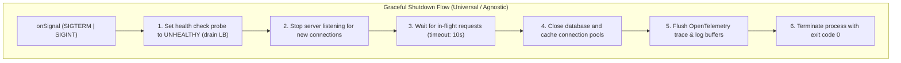
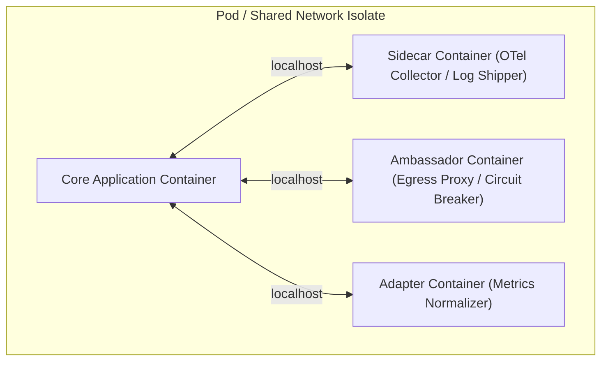

# Cloud-Native 12-Factor Standards (2026 Edition)

> **Core Mandate:** Enforce stateless isolates, OpenTelemetry (OTel) observability, API-first design, fast startup, and graceful disposal on SIGTERM across all execution runtimes.

---

## 1. Stateless Isolates & Shared-Nothing

- Application processes must be strictly stateless and share nothing.
- Any persistent state must reside in external, managed backing services (relational databases, document stores, distributed caches, object storage).
- User sessions and conversational state must never be held in local process memory.

---

## 2. OpenTelemetry (OTel) Standardization

- Standardize exclusively on open-source **OpenTelemetry** across all language runtimes.
- Export traces, metrics, and logs in vendor-neutral **OTLP (OpenTelemetry Protocol)** format over gRPC (port 4317) or HTTP (port 4318) to an OpenTelemetry Collector.
- Propagate distributed trace context across service boundaries using standard W3C `traceparent` and `tracestate` headers.

---

## 3. Disposability & Graceful Shutdown

All application processes and containers must handle graceful termination:
- Trap operating system `SIGTERM` and `SIGINT` signals.
- Cease accepting new inbound HTTP/gRPC requests immediately upon signal receipt.
- Drain active, in-flight connections within a bounded timeout window (e.g. 10 seconds).
- Gracefully flush telemetry buffers, terminate background workers, and close database/cache connection pools cleanly before exiting with code 0:

---

## 4. Multi-Container Composition Patterns (Burns & Ibryam)

In containerized cloud environments, modularize cross-cutting platform concerns using single-node composite container patterns (*Designing Distributed Systems* - Brendan Burns, *Kubernetes Patterns* - Bilgin Ibryam & Roland Huss):

1. **Sidecar Pattern**: Extends and augments the core application container without modifying application source code. Used for OpenTelemetry tracing collectors, file watchers, and log shipping agents.
2. **Ambassador Pattern**: Simplifies and proxies outbound access from the application container to external services (e.g. dynamic service discovery, egress rate-limiting, and mutual TLS termination).
3. **Adapter Pattern**: Standardizes and normalizes output from heterogeneous applications to conform to standard enterprise monitoring protocols (e.g. transforming proprietary XML or JSON status formats into standard Prometheus `/metrics`).
4. **Init Container Pattern**: Separates pre-flight initialization (database schema migrations, configuration bootstrapping, permission fixes) into sequential run-to-completion containers that execute strictly before application containers boot.

---

## 5. Predictable Demands & Distributed Coordination

### 1. Predictable Demands Pattern (Resource Contracts)
- Every container must declare explicit resource `requests` and `limits`:
  - **Memory (OOMKill Defense)**: Set memory request equal to memory limit (`requests.memory == limits.memory`) to achieve **Guaranteed QoS**, preventing the Linux OOM killer from prematurely terminating the application under host memory pressure.
  - **CPU (Throttling Defense)**: Base CPU requests on measured P95 baseline utilization. Avoid overly aggressive CPU limits on multi-threaded runtimes that trigger kernel CFS throttling.

### 2. Fault Domains & Automated Spreading
- Multi-instance deployments must configure **Pod Anti-Affinity** and topology spread constraints to distribute application replicas across distinct failure domains (different physical nodes, racks, and Availability Zones).

### 3. Distributed Leader Election Pattern
- Background schedulers, recurring cron tasks, and stateful stream processors must implement distributed leader election (using distributed lease locks or consensus primitives) to guarantee that exactly one instance executes singleton operations, with seamless failover if the leader fails to refresh its lease heartbeat.
