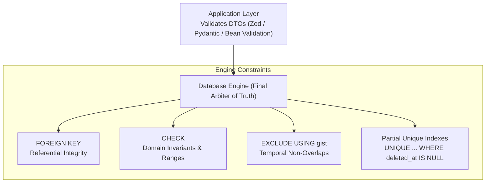
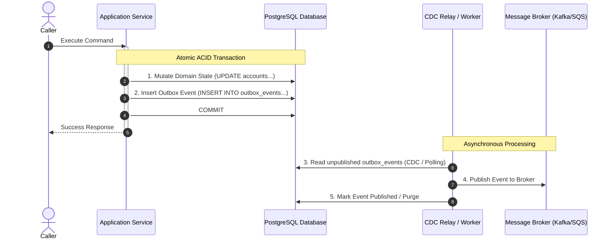

# Database Design, Relational Integrity & Transactions

> **Core Mandate:** Enforce relational constraints at the database engine level (FKs, CHECKs, EXCLUDEs), the Canonical 6 Total Audit Fields, partial soft-delete indexes, ACID transactional boundaries, and the Transactional Outbox pattern.

---

## 1. Relational Integrity & Engine-Level Constraints

Data integrity must be enforced by the relational database engine, not delegated exclusively to application code:



### Invariants:
1. **Mandatory Foreign Keys**: Every relational association must define an explicit foreign key constraint with explicit `ON DELETE` semantics (`ON DELETE RESTRICT` or `ON DELETE CASCADE`).
2. **Domain `CHECK` Constraints**: Enforce domain value ranges at the schema level:
   ```sql
   ALTER TABLE orders ADD CONSTRAINT check_positive_amount CHECK (total_amount >= 0);
   ALTER TABLE users ADD CONSTRAINT check_valid_role CHECK (role IN ('ADMIN', 'OPERATOR', 'MEMBER'));
   ```
3. **Temporal Non-Overlap (`EXCLUDE`)**: Scheduling, booking, or reservation systems must prevent double-booking using PostgreSQL range exclusion constraints:
   ```sql
   ALTER TABLE bookings ADD CONSTRAINT no_overlapping_reservations
     EXCLUDE USING gist (room_id WITH =, reservation_period WITH &&);
   ```

---

## 2. The Canonical 6 Total Audit Fields

Every mutable stateful entity in the database must implement the **Canonical 6 Total Audit Fields** to guarantee complete traceability for compliance and security audits:

```sql
CREATE TABLE resources (
  id UUID PRIMARY KEY DEFAULT gen_random_uuid(),
  tenant_id UUID, -- Included in multi-tenant schemas; omitted in single-tenant systems
  name VARCHAR(255) NOT NULL,
  
  -- The Canonical 6 Total Audit Fields
  created_at TIMESTAMPTZ NOT NULL DEFAULT clock_timestamp(),
  created_by UUID, -- Populated from ambient actor context; system/nil in local/single-user tools
  updated_at TIMESTAMPTZ NOT NULL DEFAULT clock_timestamp(),
  updated_by UUID,
  deleted_at TIMESTAMPTZ,
  deleted_by UUID
);
```

### Rules & Append-Only Exception:
- **Mutable Entities:** In multi-user and enterprise schemas, all 6 fields ensure complete auditability. Repositories automatically populate `createdBy`/`updatedBy` from the ambient authenticated actor context. In local single-user CLI tools or embedded SQLite stores, `tenant_id` is omitted and actor IDs default to system constants.
- **Append-Only Event / Ledger Tables:** Immutable append-only tables (event streams, audit logs, metric series) omit `updated_at`, `updated_by`, `deleted_at`, and `deleted_by` because records are never updated or deleted.


---

## 3. Soft-Delete Invariants & Partial Unique Indexes

When implementing soft-delete (`deleted_at IS NOT NULL`):
1. **Never Use Unfiltered Unique Constraints**: A standard `UNIQUE(slug)` constraint prevents creating a new record with the same slug after deleting an old record.
2. **Mandatory Partial Unique Index**:
   ```sql
   -- Correct: Allows reusing slug after soft-deletion
   CREATE UNIQUE INDEX idx_resources_tenant_slug_active 
     ON resources (tenant_id, slug) 
     WHERE deleted_at IS NULL;
   ```
3. **Soft-Delete Query Filtering**: All read queries must filter `WHERE deleted_at IS NULL` unless explicitly requesting archived records.

---

## 4. ACID Transactions & Isolation Levels

Every operation mutating multiple database rows or coordinating interrelated aggregates must execute within an explicit **ACID Transaction**:

### Transaction Guidelines & The 5 Concurrency Anomalies (Martin Kleppmann - *DDIA*):
- **Single Aggregate Transactions**: Strive to keep transactions bounded to a single aggregate root.
- **The 5 Classic Race Conditions & Their Isolation Defenses**:
  1. **Dirty Reads**: A transaction reads uncommitted changes from another transaction. *Defense: `READ COMMITTED` (PostgreSQL default).*
  2. **Dirty Writes**: One transaction overwrites uncommitted data written by another. *Defense: Engine row-level write locks.*
  3. **Read Skew (Non-Repeatable Reads)**: A transaction observes inconsistent snapshots across different queries as concurrent transactions commit. *Defense: Snapshot Isolation (PostgreSQL `REPEATABLE READ` via MVCC).*
  4. **Lost Updates**: Concurrent read-modify-write cycles overwrite each other's changes. *Defense: Atomic expressions (`UPDATE accounts SET balance = balance - 50`) or pessimistic locking (`SELECT ... FOR UPDATE`).*
  5. **Write Skew & Phantom Reads**: Two transactions read the same precondition rows and concurrently make writes that violate a business invariant. *Defense: `SERIALIZABLE` isolation (Serializable Snapshot Isolation / SSI) or explicit conflict materialization.*
- **Unreliable Wall Clocks in Distributed Systems (Kleppmann)**: Physical server wall clocks drift significantly (NTP skew). Never use wall-clock timestamps for causal ordering or distributed consensus. Rely on monotonically increasing sequence numbers, database sequences, or Lamport/version vectors.
- **Defensive Timeouts**: Transactions must never run indefinitely. Always set a defensive statement and transaction timeout:
  ```sql
  SET LOCAL statement_timeout = '5s';
  SET LOCAL idle_in_transaction_session_timeout = '10s';
  ```

---

## 5. The Transactional Outbox Pattern (Dual-Write Defense)

Never execute a database write and a message broker publish sequentially in application code. If the network fails between the two operations, the system enters an inconsistent, corrupted state (**The Dual-Write Anti-Pattern**).



### Outbox Invariants:
1. **Atomic Ingestion**: Domain entity mutation and event insertion must share the identical database transaction.
2. **Guaranteed At-Least-Once Delivery**: The outbox relay guarantees delivery to consumers; consumers must implement idempotency.

---

## 6. Storage Engine Invariants & Relational Normalization (Petrov & Hernandez)

Grounded in Alex Petrov (*Database Internals*) and Michael J. Hernandez (*Database Design for Mere Mortals*):

### 6.1. Storage Engine Primitives (B-Trees vs. LSM-Trees - Alex Petrov)
- **B-Tree Storage (PostgreSQL, MySQL InnoDB, SQLite):** Optimized for low-latency point lookups, range scans, and in-place updates. Writes incur random I/O and page fragmentation. Must rely on Write-Ahead Logging (WAL) to ensure ACID durability before in-memory buffer pool pages are flushed to disk.
- **LSM-Tree Storage (Cassandra, RocksDB):** Optimized for write-heavy append workloads. Sequential disk writes into in-memory Memtables flushed to immutable Sorted String Tables (SSTables). Background compaction eliminates tombstoned deletions; read queries trade latency for write throughput.
- **Write-Ahead Log (WAL) Invariant:** Never disable or bypass WAL (`fsync`) for performance in production. Transactions are only committed once their corresponding log sequence number (LSN) is verified durable on disk.

### 6.2. Relational Normalization Invariants (Hernandez)
The write-side primary OLTP database must maintain strict Third Normal Form (3NF):
- **1NF (First Normal Form):** Every attribute is atomic; zero repeating column groups (e.g. `phone_1`, `phone_2`) and zero multi-value delimited strings (`tags: "a,b,c"`). Use dedicated relational child tables.
- **2NF (Second Normal Form):** Every non-key attribute is fully functionally dependent on the entire primary key, not a subset of a composite key.
- **3NF (Third Normal Form):** Zero transitive dependencies; non-key attributes must never depend on other non-key attributes. Computed columns (e.g. `total_price = quantity * unit_price`) must not be stored in write tables unless governed by deterministic database generated column expressions.
- **Denormalization Guardrail:** Denormalization is strictly prohibited in the write-model. Spliced views, cached aggregations, and denormalized documents belong exclusively to read projections ([`cqrs.md`](./cqrs.md)).

