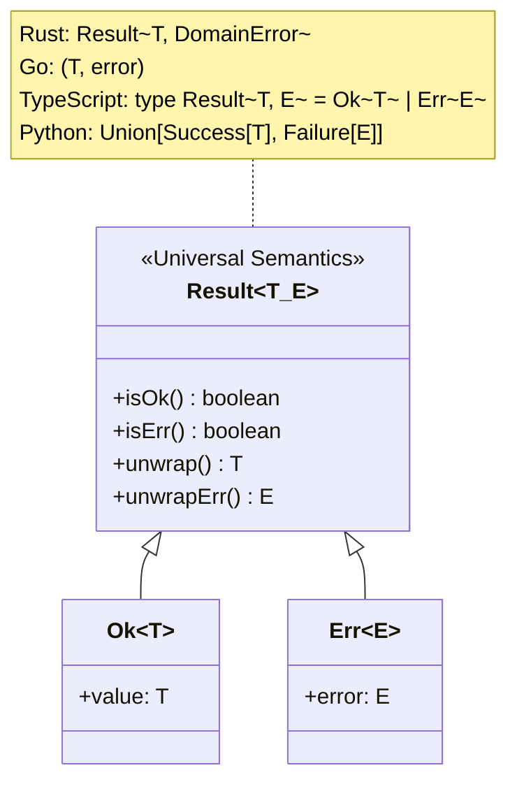

# Modern Design Patterns & Result Pattern

> **Core Mandate:** Enforce composition over inheritance, wrap third-party boundaries in project-owned adapters, and model domain errors with explicit Result types instead of untyped exceptions.

---

## 1. Foundational Design Principles & Structural Patterns

### The Two Foundational Principles of Object-Oriented Design (GoF)
1. **Program to an interface, not an implementation**: Clients remain completely decoupled from concrete classes as long as objects adhere to the interface contract.
2. **Favor object composition over class inheritance**: Inheritance exposes subclass implementation to parent internals (white-box reuse); object composition achieves black-box reuse and allows dynamic runtime swapping.

### The YAGNI Gate for Design Patterns
- Patterns are not design goals; they are solutions to recurring structural friction.
- Never apply a Gang of Four pattern speculatively on Day 1. Follow the **Rule of Three**: implement simple direct logic first, and introduce polymorphic Strategy, Factory, or Decorator structures only when the 3rd variant or proven variance tipping point occurs.

### Core Creational & Structural Standards
- **Adapter Pattern (Hexagonal Boundary)**: Wrap all external libraries, database drivers, cloud SDKs, and third-party APIs in project-owned adapter interfaces. *Rule: Only mock types you own.*
- **Factory Method**: Encapsulate complex collaborator instantiation (e.g. tenant-specific payment gateways or notification dispatchers) behind factory functions.
- **Facade Pattern**: Expose a unified, simplified interface to complex underlying multi-service subsystems.
- **Decorator / Middleware**: Compose cross-cutting concerns (observability, authentication, tenant context resolution, rate limiting) via middleware pipelines.
- **Resist the Singleton Trap** (Kevlin Henney & Sam Saariste): Avoid global static singletons (`getInstance()`). Global singletons are disguised global variables that create hidden temporal coupling, prevent concurrent test isolation, and obscure dependencies. Manage singleton lifecycles exclusively through Dependency Injection (DI) scoping or composition root assembly.
- **Dependency Injection & Composition Hygiene**: Application factories (`createApp(deps)`) must accept an explicit composite container (`AppDependencies`). Never provide silent default fallback instances inside factories that instantiate disconnected repositories or services when partial dependencies are passed (the Split-Brain Anti-Pattern). Assemble the full dependency graph explicitly at the composition root.

---

## 2. Behavioral Patterns & Explicit Result Types

- **Strategy Pattern**: Swap algorithms or execution behavior at runtime without code changes (e.g. tenant-specific pricing algorithms, shipping calculation strategies).
- **Result / Either Pattern**: Model anticipated domain errors as explicit return values (`Result<T, E>`) rather than throwing untyped exceptions across architectural boundaries:

Domain services must return explicit Result types, compelling callers to handle failure branches deterministically.

---

## 3. Gang of Four (GoF) 23 Patterns Master Catalog

### A. Creational Patterns (5 Patterns)
1. **Factory Method**: Define an interface for creating an object, but let subclasses or factory functions decide which class to instantiate.
   - *Use Case:* Tenant-specific payment gateway instantiation (`StripeAdapter` vs `PayPalAdapter`).
2. **Abstract Factory**: Provide an interface for creating families of related or dependent objects without specifying concrete classes.
   - *Use Case:* Multi-cloud storage factories creating matching `FileUploader`, `FileDownloader`, and `PresignedUrlGenerator` for S3, GCS, or MinIO.
3. **Builder**: Separate the construction of a complex object from its representation, allowing the same construction process to create different representations.
   - *Use Case:* Fluent query builders, complex report generators, or test data builders (`OrderBuilder.withItems(...).build()`).
4. **Prototype**: Specify the kinds of objects to create using a prototypical instance, creating new objects by cloning this prototype.
   - *Use Case:* Fast cloning of default tenant configuration templates without querying storage.
5. **Singleton (DI-Scoped)**: Ensure a class has only one instance and provide a global point of access.
   - *Rule:* Avoid global static singletons (causes test coupling). Enforce singleton lifecycle strictly through Dependency Injection (DI) containers.

### B. Structural Patterns (7 Patterns)
6. **Adapter (Mandatory)**: Convert the interface of a class into another interface clients expect.
   - *Use Case:* Wrapping 3rd-party SDKs, storage drivers, and external network clients in application-owned interfaces. *Rule: Only mock types you own.*
7. **Bridge**: Decouple an abstraction from its implementation so the two can vary independently.
   - *Use Case:* Decoupling notification abstractions (`UrgentNotification`, `BatchNotification`) from delivery channels (`EmailChannel`, `SlackChannel`).
8. **Composite**: Compose objects into tree structures to represent part-whole hierarchies.
   - *Use Case:* Nested RBAC permission trees or hierarchical menu navigation systems.
9. **Decorator**: Attach additional responsibilities to an object dynamically as a flexible alternative to subclassing.
   - *Use Case:* Wrapping repository methods with distributed caching, OpenTelemetry tracing, or metrics logging.
10. **Facade**: Provide a unified, high-level interface to a complex set of interfaces in a subsystem.
    - *Use Case:* Checkout facade orchestrating inventory verification, payment processing, invoice generation, and email notification.
11. **Flyweight**: Use sharing to support large numbers of fine-grained objects efficiently.
    - *Use Case:* In-memory sharing of immutable tenant metadata and shared system role permission definitions.
12. **Proxy**: Provide a surrogate or placeholder for another object to control access to it.
    - *Use Case:* Lazy-loading database relations, virtual proxies for large assets, or tenant-scoped connection proxies.

### C. Behavioral Patterns (11 Patterns)
13. **Chain of Responsibility**: Pass requests along a chain of handlers until a handler processes it or the chain ends.
    - *Use Case:* Inbound gateway middleware pipelines (Authentication ➔ TenantResolution ➔ RateLimiting ➔ Controller).
14. **Command**: Encapsulate a request as an object, thereby letting you parameterize clients with different requests, queue or log requests, and support undo.
    - *Use Case:* Asynchronous job queues, transactional audit commands, CQRS command handlers.
15. **Interpreter**: Given a language, define a representation for its grammar along with an interpreter that uses the representation to interpret sentences.
    - *Use Case:* Custom search filter parsers (`status:active AND tier:pro`) or rule engine expression evaluation.
16. **Iterator**: Provide a way to access the elements of an aggregate object sequentially without exposing its underlying representation.
    - *Use Case:* Async iterators streaming large database cursor result sets or reading multi-part upload chunks.
17. **Mediator**: Define an object that encapsulates how a set of objects interact, preventing direct coupling between them.
    - *Use Case:* In-memory event dispatcher mediating communication between decoupled domain services.
18. **Memento**: Without violating encapsulation, capture and externalize an object's internal state so the object can be restored to this state later.
    - *Use Case:* Audit trail snapshots recording `before` and `after` states for rollback capabilities.
19. **Observer**: Define a one-to-many dependency between objects so that when one object changes state, all its dependents are notified automatically.
    - *Use Case:* Domain Event buses (`UserRegisteredEvent`, `PaymentFailedEvent`) invoking multiple listeners.
20. **State**: Allow an object to alter its behavior when its internal state changes, appearing as if it changed its class.
    - *Use Case:* Subscription lifecycles (`TrialState` ➔ `ActiveState` ➔ `PastDueState` ➔ `CanceledState`) where allowed actions change dynamically.
21. **Strategy**: Define a family of algorithms, encapsulate each one, and make them interchangeable at runtime.
    - *Use Case:* Dynamic fee calculation, tenant-specific password complexity policies, or feature flag evaluation providers.
22. **Template Method**: Define the skeleton of an algorithm in an operation, deferring some steps to subclasses.
    - *Use Case:* Base ETL or data import pipelines with fixed steps (Extract ➔ Validate ➔ Transform ➔ Persist) where subclasses define validation.
23. **Visitor**: Represent an operation to be performed on the elements of an object structure, defining a new operation without changing the classes of the elements.
    - *Use Case:* Document export engines traversing an AST of content blocks to generate HTML, Markdown, or PDF.

---

## 4. Enterprise Application Architecture Patterns (Martin Fowler)

Enterprise applications handling complex business workflows must structure domain and persistence layers according to Fowler's canonical patterns (*Patterns of Enterprise Application Architecture*):

### 1. Domain Logic Sizing: Transaction Script vs. Domain Model
- **Transaction Script**: Organizes business logic by procedural subroutines where each procedure handles a single request from presentation directly to storage. Acceptable only for simple command-line scripts or trivial CRUD. Degenerates into duplicated validation and unmaintainable branching as business rules grow.
- **Domain Model**: An object-oriented network of entities and value objects incorporating both data and behavior. Mandatory for systems with complex rules, invariant validation, and multi-step state transitions.
- **Service Layer**: Defines an application's perimeter boundary with a set of available operations, coordinating transactional workflows, authorization guards, and notifications while delegating business rules strictly to domain entities.

### 2. Data Source Architectural Patterns
- **Data Mapper vs. Active Record**:
  - *Active Record:* An object that wraps a database row, encapsulates database access, and adds domain logic. Tightly couples domain code to database tables and ORM schemas. Forbidden in core domain logic; permissible only in simple CRUD utilities or migration scripts.
  - *Data Mapper:* A layer of mappers that moves data between domain objects and a database while keeping them completely independent of each other and of the mapper itself. Mandatory in Hexagonal and Clean architectures.
- **Unit of Work**:
  - Maintains a ledger of objects affected by a business transaction (new, modified, deleted) and coordinates the writing out of changes and concurrency resolution in a single atomic database transaction. Prevents fragmented multi-roundtrip writes.
- **Identity Map**:
  - Ensures that each database record is loaded into memory only once per business transaction/unit-of-work. If an entity is queried multiple times in a single request, the Identity Map returns the identical in-memory instance, preventing stale overwrites, split-brain modifications, and redundant queries.
- **Repository vs. Data Access Object (DAO)**:
  - A *DAO* is an abstraction over a database table or relational query.
  - A *Repository* mediates between domain and data mapping layers acting like an in-memory collection of domain Aggregates. Repositories deal with Aggregate Roots (`OrderRepository`), never individual child table rows (`OrderItemDAO`).

---

## 5. Working Effectively with Legacy Code (Michael C. Feathers)

Modifying untested legacy code is high-risk. Follow Feathers' battle-tested refactoring patterns (*Working Effectively with Legacy Code*):

1. **The Legacy Code Dilemma**: To change code safely, tests must be in place. To put tests in place, code often must be changed. Break this paradox using **Seams**.
2. **The Concept of Seams**: A seam is a place where you can alter program behavior without editing code in that place.
   - *Object Seams:* Subclassing a collaborator and overriding a method to inject a mock in a test.
   - *Link / Interface Seams:* Introducing an interface between a consumer and an external SDK so a test double can be swapped at link or compile time.
3. **Characterization Tests**: When legacy code lacks tests, write tests that preserve and document *current actual behavior* (including known quirks or bugs) before making any code modifications. This creates a safety net against unintended regressions.
4. **Sprout Method & Sprout Class**:
   - When adding new functionality to an existing large, untested legacy class, write the new logic as a pristine, unit-tested standalone method (*Sprout Method*) or class (*Sprout Class*).
   - Call the sprouted component from the legacy location with minimal surface disruption.
5. **Wrap Method & Wrap Class (Decorator)**:
   - To execute new pre-conditions or post-conditions around an existing legacy method, wrap the original method with a new method that delegates to it, keeping new concerns cleanly separated from legacy debt.
