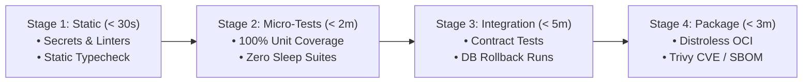

# DevOps, CI/CD, Container Infrastructure & DevSecOps

> **Core Mandate:** Enforce trunk-based continuous integration with shift-left automated gates, minimal distroless OCI container packaging, non-root execution security, software supply chain verification (SBOM & Trivy), and zero-downtime continuous deployment.

---

## 1. Continuous Integration & Trunk-Based Development

CI pipelines must execute fast, deterministic, shift-left quality gates on every commit and pull request:

```
[Local Commit] ──► [Pre-Commit Hook] ──► [Pull Request] ──► [Automated CI Gate] ──► [Merge to Main]
                    • Secretlint          • Build Cache      • Lint & Format Check
                    • Type Check                             • 100.00% Test Coverage
                                                             • DevSecOps CVE Scan
```

### Invariants:
1. **Trunk-Based Development**: Feature branches must be short-lived ($\le 24$ hours) and merged into `main` continuously. Avoid long-lived feature branches that cause painful merge conflicts.
2. **Shift-Left Automated PR Gates**: Every PR must pass automated CI checks before merge:
   - Zero linter or syntax errors (`npm run lint` / `cargo clippy`).
   - Strict type-checking (`tsc --noEmit` / `mypy`).
   - 100.00% automated test coverage gate.
3. **Deterministic Build Caching**: Cache dependency directories (`~/.pnpm-store`, `~/.cargo`, `~/.cache/uv`) and Docker layer caches to maintain pipeline execution times under 3 minutes.

---

## 2. Secure OCI Container Infrastructure

All production container images must follow strict security minimization standards:

```dockerfile
# Multi-Stage Build Pattern
FROM node:22-alpine AS builder
WORKDIR /app
COPY package.json pnpm-lock.yaml ./
RUN corepack enable && pnpm install --frozen-lockfile
COPY . .
RUN pnpm build

# Minimal Distroless Runtime Stage
FROM gcr.io/distroless/nodejs22-debian12:nonroot
WORKDIR /app
COPY --from=builder --chown=nonroot:nonroot /app/dist ./dist
COPY --from=builder --chown=nonroot:nonroot /app/node_modules ./node_modules
USER nonroot
EXPOSE 3000
ENTRYPOINT ["node", "dist/index.js"]
```

### Invariants:
1. **Multi-Stage Builds**: Build tools, package managers, and compilers must never leak into final runtime images.
2. **Minimal Distroless / Scratch Base**: Use Google Distroless or `scratch` images. Never ship package managers (`apt`, `apk`), shells (`bash`, `sh`), or debugging utilities in production images.
3. **Non-Root Execution**: Containers must never run as UID 0 (`root`). Always specify an unprivileged user (`USER nonroot:nonroot` or `USER 10001:10001`).
4. **Read-Only Root Filesystem**: Configure container runtimes with `read_only: true`, mounting ephemeral tmpfs only to designated writable directories (`/tmp`).

---

## 3. DevSecOps & Supply Chain Security

Security checks must be embedded directly into developer workflows and automated pipelines:

1. **Pre-Commit Secret Scanning**: Gating tools (e.g. **Secretlint**, **Gitleaks**) must block commits containing private keys, API tokens, passwords, or cloud credentials.
2. **Software Bill of Materials (SBOM)**: Every release artifact must generate a machine-readable SBOM in **CycloneDX** or **SPDX** format (using `syft` or `cyclonedx-cli`) documenting all direct and transitive dependencies.
3. **Automated Vulnerability Scanning**: Scan container images and dependencies with **Trivy** or **Grype** in CI. Automatically fail pipelines on unpatched `CRITICAL` or `HIGH` Common Vulnerabilities and Exposures (CVEs).

---

## 4. Continuous Deployment & Zero-Downtime Rollouts

1. **Zero-Downtime Deployment Strategy**: Deployments must utilize rolling updates, canary releases, or blue/green switches. New container instances must pass readiness probes before receiving production traffic.
2. **Container Health & Lifecycle Probes**:
   - `readinessProbe`: Validates database connectivity and dependency readiness before routing HTTP traffic.
   - `livenessProbe`: Detects deadlocks and restarts unresponsive containers.
   - Graceful Shutdown: Handle `SIGTERM` deterministically by draining in-flight requests within a 30-second termination window.
3. **Cryptographic Image Signing**: Sign container images with **Cosign** (Sigstore) during CI, and enforce admission controller verification in production clusters.

---

## 5. Pipeline as Code & Progressive Delivery (Labouardy & The DevOps Handbook)

CI/CD automation must be governed as software engineering artifacts (*Pipeline as Code* - Mohamed Labouardy, *The DevOps Handbook* - Gene Kim et al.):

### 1. Declarative, Version-Controlled Pipelines
- All pipeline configurations (`.github/workflows/ci.yml`, `Jenkinsfile`) must be version-controlled in the repository alongside application source code.
- Pipeline definitions must be modular, declarative, and subjected to the same linting, code review, and static validation as production code.

### 2. Fast-Fail Pipeline Gate Sequencing
Pipelines must enforce a strict fail-fast hierarchy to preserve developer feedback cycles and compute resources:



- If Stage 1 fails, subsequent resource-intensive stages must be aborted immediately.
- The entire CI cycle from commit to deployment readiness must complete in under 10 minutes.

### 3. Ephemeral Preview Environments per Pull Request
- Every PR introducing UI or API mutations must be capable of automatically provisioning an ephemeral, containerized preview environment.
- Ephemeral environments must be provisioned with seeded test fixtures and destroyed automatically upon PR merge or closure.

### 4. Canary Verification & Automated Metric Rollback
- Deployments to production must follow progressive canary routing:
  1. Route 5% of production traffic to the new revision.
  2. Monitor OpenTelemetry Golden Signals (HTTP 5xx rate, P99 latency) for 10 minutes.
  3. If error rates exceed 0.5% or P99 latency regresses by $> 20\%$, trigger an immediate automated rollback.
  4. If healthy, graduate traffic to 25%, 50%, and 100%.
