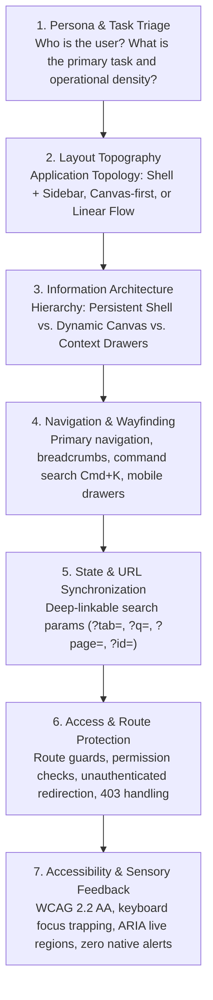
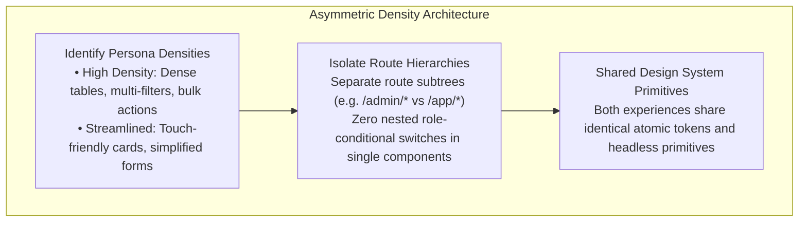

# UI/UX Architecture, Design Triage & Navigation Systems

> **Core Mandate:** Enforce mandatory upfront Design Architecture Triage before writing UI code, persistent shell and viewport separation adapted to application topology, bidirectional URL state synchronization, accessible design tokens (WCAG 2.2 AA), and strict decoupling of developer test harnesses from production authentication.

---

## 1. The Design Architecture Triage Gate

A catastrophic software defect occurs when frontend architecture is built ad-hoc without structural triage—resulting in tangled navigation, broken responsive layouts, inaccessible components, and unsharable view states.

Before a single UI component or view is authored, every user interface increment must pass the **7-Pillar Design Architecture Triage Gate**:



---

## 2. Layout Topography & Universal Application Topologies

Select the layout topology that directly matches the problem domain and user workflow:

### Topology A: Persistent Navigation Shell (Data & Management Interfaces)
- **Persistent Global Header / Rail**: Brand anchor, global search (`Cmd + K`), notifications, active workspace/context switcher, and user profile.
- **Collapsible Navigation (Sidebar or Rail)**: Primary module navigation. Collapses smoothly to an icon rail (`w-16` / 64px) with tooltips to maximize canvas working area on desktop.
- **Dynamic Viewport Canvas**: Breadcrumbs, view title, primary action CTA, view-level tabs, and data presentation (tables, grids, cards).
- *Rule:* The outer shell must never re-render across inner route navigations.

### Topology B: Canvas-First & Immersive (Creative, Document & Analytical Tools)
- Maximizes screen real estate for direct manipulation (editors, canvas boards, media players, notebooks).
- Toolbars and inspectors are contextual, floating, or docking drawers that can be hidden to prevent cognitive overload.

### Topology C: Focused Sequential Flows (Onboarding, Wizards & Multi-Step Forms)
- Minimalist distraction-free layout with persistent step progress indicators.
- Global navigation is hidden or restricted to prevent abandonment and state corruption during multi-step atomic sequences.

---

## 3. Asymmetric Information Density & Multi-Persona Architecture

When an application serves user personas with fundamentally different operational requirements (e.g. administrative operators needing high-density data tables and bulk actions vs. casual end-users needing simplified card views and touch ergonomics):



### Invariants:
1. **Zero Conditional Component Spaghetti:** Never place deeply nested `if (user.role === 'admin')` checks inside individual presentation components to render entirely different screens. Split distinct experiences into dedicated, decoupled page components mounted on separate route subtrees.
2. **Unified Design System Foundation:** Distinct personas must share the same foundational design tokens (colors, typography, spacing, border radii) to preserve visual consistency across the organization.

---

## 4. Production Authentication vs. Developer Test Harness Hygiene

### 4.1. Strict Decoupling Mandate
- **Never embed hardcoded demo personas or mock user switcher buttons into production authentication forms.** Conflating test credentials with actual authentication introduces severe security vulnerabilities and destroys production UX integrity.
- **Production Sign-In (`/login`)**:
  - Clean, dedicated sign-in form with real-time schema validation.
  - Accessible error alerts (`role="alert"`) and clear recovery flows.
- **Developer Test Persona Harness**:
  - Must be **100% decoupled** from production forms and gated strictly behind development environment flags:
    ```tsx
    // Rendered exclusively in development / preview mode
    if (import.meta.env.DEV) {
      return <DevPersonaToolbar onSwitchUser={handleDevUserSwitch} />;
    }
    ```
  - Visibly labeled as a development tool. Switching personas must clear active query caches and reload ambient session state cleanly.

---

## 5. Declarative Route Guarding & Access Control

- **Defense in Depth**: Hiding a UI button or menu item based on user role is an ergonomic convenience, **never security**. Every sensitive operation must be guarded by backend authorization policies.
- **Declarative Route Guards**:
  - Protect route subtrees using declarative wrapper components:
    ```tsx
    <Route element={<ProtectedRoute requiredPermissions={['manage:resources']} />}>
      <Route path="/resources" element={<ResourceListPage />} />
      <Route path="/resources/:id" element={<ResourceDetailPage />} />
    </Route>
    ```
  - Unauthenticated access attempts must redirect to `/login?returnTo=<encoded-path>`.
  - Authenticated requests lacking required permissions must render an accessible `403 Forbidden` screen with clear navigation back to authorized zones.

---

## 6. Bidirectional URL State Synchronization

Per [`docs/rules/frontend_architecture.md`](./frontend_architecture.md), all view state that represents navigation, active tab, filtering, sorting, pagination, search queries, or active detail selection must synchronize bidirectionally with URL search parameters:
- **Tabs & Views:** `?tab=overview`, `?tab=history`
- **Filters & Search:** `?status=active&category=core`, `?q=search_term`
- **Pagination & Sorting:** `?page=2&pageSize=25&sort=-createdAt`
- **Active Selection / Drawers:** `?selectedId=res_123`
- *Invariant:* Pasting a URL into a new browser tab must reconstruct the exact same view state without requiring manual re-navigation.

---

## 7. Production UI Hygiene & Resilience Standards

1. **Fault-Tolerant Error Boundaries:** Wrap route outlets, complex widgets, and third-party embeds in accessible `<ErrorBoundary>` components. A render exception in one widget must never crash the entire application shell.
2. **Centralized UI Copy (`UI_STRINGS`):** Centralize user-facing copy, labels, validation messages, and action button text in structured constants or localization dictionaries rather than scattering hardcoded strings across presentation templates.
3. **Multi-Tab State Synchronization:** Synchronize cross-tab session mutations (e.g. sign-out, workspace switch) using native `window.addEventListener('storage')`.
4. **Accessible Feedback Layer:** Trigger accessible toast notifications (`role="status"`) and inline alerts (`role="alert"`). Never use blocking native browser dialogs (`window.alert`, `window.confirm`).
